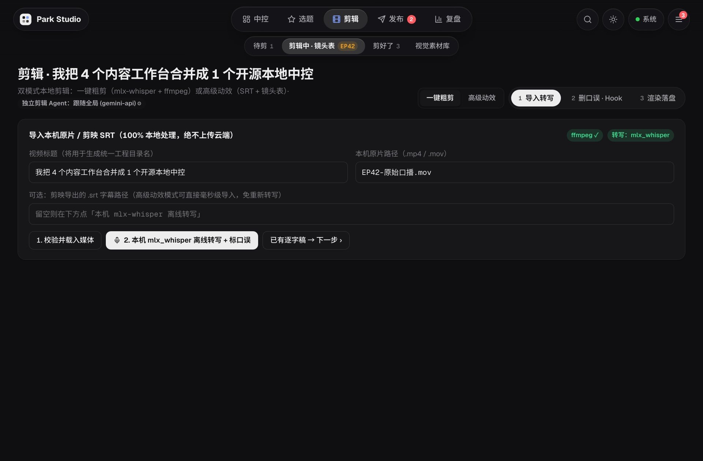
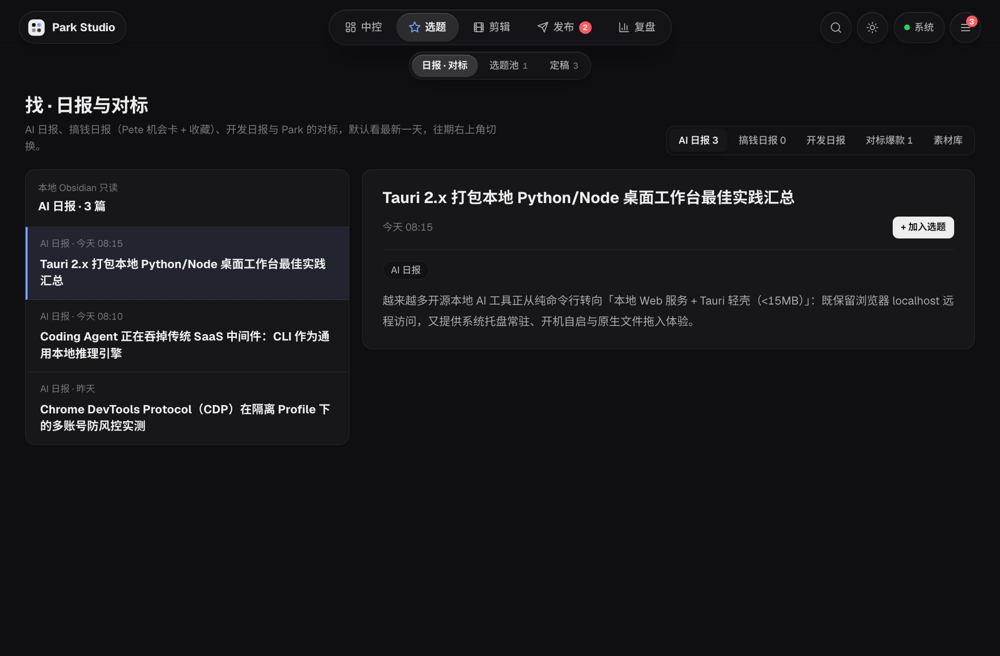
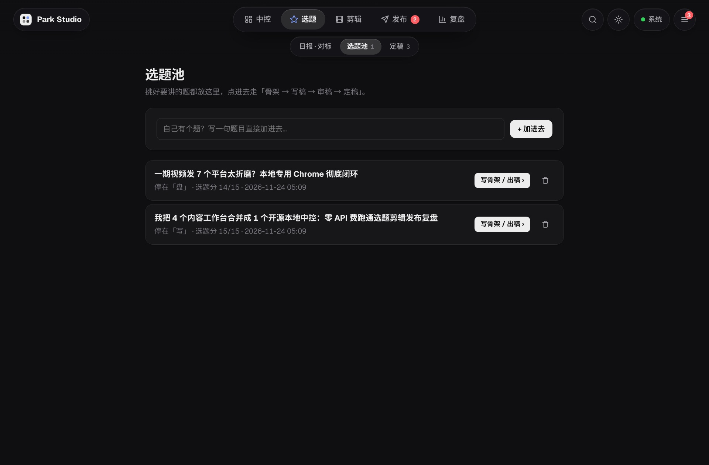
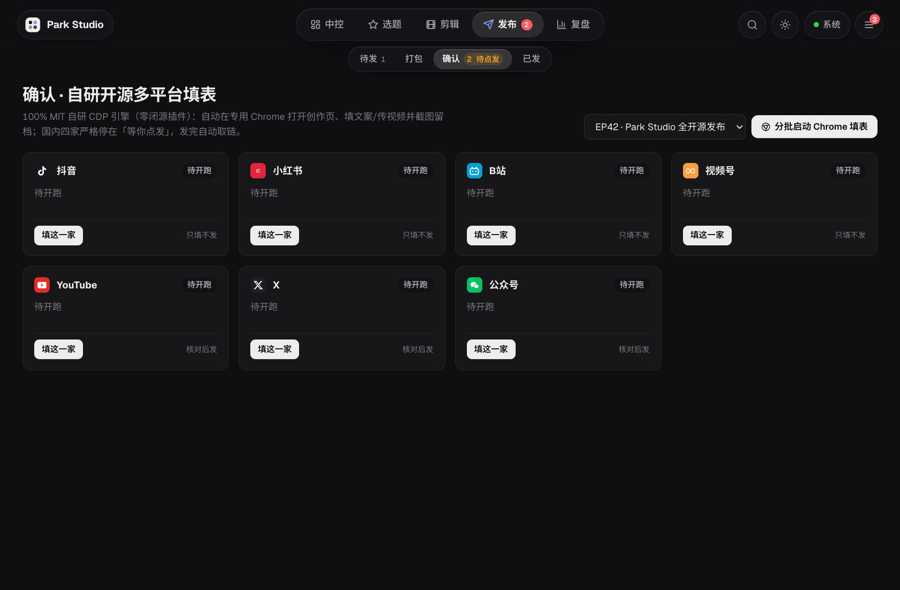
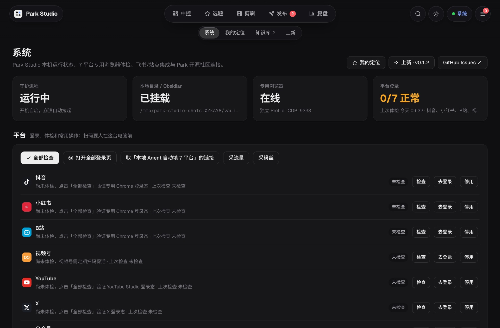
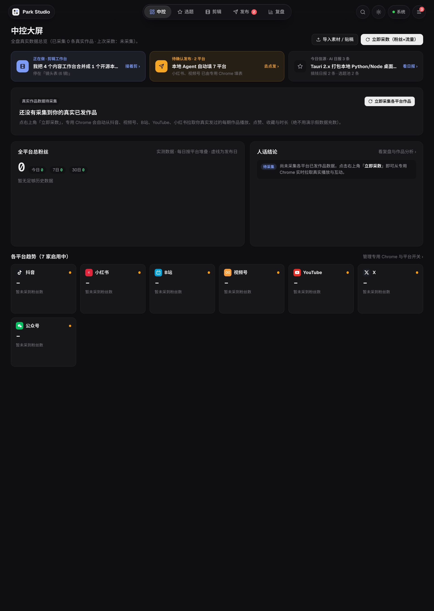

<div align="center">

# Park Studio

**简体中文** → [README.md](README.md) · **English**

> *"You record one 10-minute talking-head video, then burn 2 hours cutting pauses, rewriting captions, and re-uploading to a dozen dashboards."*

[](https://python.org)
[](https://fastapi.tiangolo.com)
[](https://github.com/zinan92/park-studio/releases/latest)
[](https://github.com/zinan92/park-studio/releases/tag/v0.5.0)
[](LICENSE)

**A local-first open-source Creator OS uniting Topics → Dual-Mode Local Video Cutting → 12-Platform Opt-In CDP Draft Auto-Fill (with AI ZH→EN Localization) → Real Cross-Platform Analytics. 100% on your disk.**

[Screenshots](#screenshots) · [Why It Exists](#why-it-exists) · [Quick Start](#quick-start) · [Architecture](#architecture) · [Safety Boundaries](#safety-boundaries) · [API Reference](#api-reference) · [For AI Agents](#for-ai-agents)

</div>

---

<p align="center"></p>
<p align="center"><sub>Park Studio Dual-Mode Cut Workbench: auto-detects local ffmpeg & mlx-whisper for 1-click rough cuts or Spec Table motion planning via an independent Cut Agent.</sub></p>

```text
in   Read-only Obsidian Vault + Viral Benchmark Notes + Raw .mp4/.mov or .srt + Local AI CLI / API
out  Final Scripts + Standard Episode Folder (final/上传/) + -16 LUFS faststart MP4 + English .srt + Localized 12-Platform Drafts + Real SQLite Analytics

fail ffmpeg / mlx-whisper missing       -> Cut Workbench health pills turn red with exact install commands
fail Platform session expired           -> Isolated Chrome CDP aborts fill and flags re-login (never misposts)
fail Video upload box not found         -> Strict read-back gate marks Failed with screenshot & retry (zero fake success)
fail No published works collected yet   -> Hub & Review show honest empty states with Sync button (zero fake numbers)
```

Adapters: `gemini-api` · `agy (Antigravity CLI)` · `gemini` · `claude` · `codex` · `openai-compatible api (DeepSeek / OpenAI / OpenRouter / Ollama)` · `mlx-whisper` · `faster-whisper` · `chrome-cdp (:9333)`

---

## Why It Exists

Every solo creator hits the same fragmented wall: ideas live in Obsidian and bookmarks; raw recordings need silence/retake removal, loudness normalization, and subtitles; then the finished video, thumbnails, and localized captions have to be pasted into **YouTube, X, TikTok, Instagram, Threads, LinkedIn, Meta Business Suite, Douyin, Xiaohongshu, Bilibili, WeChat Channels, and WeChat OA**.

**Park Studio** folds the entire loop into one zero-build local FastAPI + SQLite app (with a 1.7 MB native Swift `WKWebView` macOS shell) and a built-in **`ZH / EN` bilingual UI switch**:

```text
[ Hub | Topics | Cut | Publish | Review ]
```

- **12 platforms supported, zero obligation to fill all 12**: First-run Onboarding lets you pick only the 1, 3, or 5 platforms you actually publish to. Unselected platforms stay cleanly hidden everywhere and can be toggled anytime in **System**.
- **AI Multi-Platform Localization (ZH → EN + Platform Voice)**: One click rewrites your draft title, caption, and hashtags into idiomatic English for global platforms (YouTube SEO, punchy X/Threads hooks, builder-voice LinkedIn, short TikTok/IG captions) and tailored Chinese for domestic platforms, plus 1-click English `.srt` subtitle export in the Cut Workbench.
- **Zero forced cloud fees**: Runs offline speech-to-text (`mlx-whisper` / `faster-whisper`), local `ffmpeg` rendering, isolated Chrome CDP automation, and your own AI engine (`Gemini API`, `Antigravity CLI`, `Claude Code`, `Codex`, `DeepSeek`, `OpenAI`, `OpenRouter`, or local `Ollama`).

---

## Screenshots

All screenshots are generated cleanly in an isolated temp workspace via [`scripts/capture-readme-screenshots.sh`](scripts/capture-readme-screenshots.sh) with zero private paths or cookies.

| | |
|---|---|
|  |  |
| **Topics & 7-Angle Teardown**: Read-only Obsidian dailies, 3-layer configurable viral teardown (Lite / Dan Koe 7 Angles / Deep / Custom Prompt), and 2,656 visual materials. | **Draft & Audit**: Push ideas from Pool → Draft → 3-Way Audit → Final Script with auto-scaffolded episode folders. |
|  |  |
| **Dual-Mode Cut**: Rough Cut (`mlx-whisper` + retake/pause removal + `-16 LUFS` + ASS subs + English `.srt`) or Motion Spec Table via an independent Cut Agent. | **Publish & Localize**: Auto-scan `final/上传/`, AI-localize copy per platform (`ZH → EN`), and auto-fill drafts in isolated Chrome with strict read-back verification. |
|  |  |
| **System & AI Config**: 12 opt-in platforms, visual API presets (`DeepSeek / OpenAI / OpenRouter / Ollama`), 1-click **Test AI Connection**, and ZH/EN UI switch. | **Creator Hub**: Live cross-platform follower trends, deduplicated episode metrics, and next-action focus bar. |

---

## Architecture

```text
┌───────────────────────────┐     ┌────────────────────────────────────────┐
│ Local Inputs (Read-Only)  │     │ Park Studio Engine (FastAPI + SQLite)  │
│ • Obsidian Vault & Dailies│────▶│  1. Topics: vault / 7-angle teardown   │
│ • Viral Benchmark Notes   │     │  2. Cut: mlx-whisper + ffmpeg + EN srt │
│ • Raw .mp4/.mov / .srt    │     │  3. Publish: AI ZH→EN + CDP (:9333)    │
└───────────────────────────┘     │  4. Review: live cross-platform metrics│
                                  └───────────────────┬────────────────────┘
                                                      │
         ┌────────────────────────────────────────────┼─────────────────────────────────┐
         ▼                                            ▼                                 ▼
┌─────────────────────┐                ┌─────────────────────────────┐      ┌──────────────────────┐
│ Pluggable AI Engine │                │ Standard Episode Folder     │      │ Isolated Chrome CDP  │
│ • Global Write Agent│                │ YYYY-MM-DD_<Title>/final/   │      │ • Dedicated Profile  │
│ • Dedicated Cut CLI │                │   video.mp4 + covers + copy │      │ • 12 Opt-In Platforms│
│ (Gemini/Codex/API..)│                │   + publish.json (ZH & EN)  │      │ • Fill-Only Guard    │
└─────────────────────┘                └─────────────────────────────┘      └──────────────────────┘
```

---

## Quick Start

### Option A: macOS Desktop DMG ([Release v0.4.0](https://github.com/zinan92/park-studio/releases/tag/v0.4.0) · Universal Binary)

Download `Park-Studio.dmg` from [Releases](https://github.com/zinan92/park-studio/releases/latest), drag **Park Studio.app** to Applications, and launch (requires Python 3.11+ with `fastapi uvicorn pyyaml httpx` installed locally).

### Option B: One-Line Local Source Install (macOS / Linux)

```bash
git clone https://github.com/zinan92/park-studio.git
cd park-studio
bash scripts/install.sh
```

Open `http://127.0.0.1:8792/` — click **`EN`** in the top bar (auto-detected on non-Chinese browsers) and pick only the platforms you publish to in the Onboarding modal.

### Option C: Let Your AI Agent Install It

Send [`agent-install.md`](agent-install.md) or this prompt to Gemini / Antigravity / Claude Code / Codex:

```text
Clone https://github.com/zinan92/park-studio locally, install dependencies, start it on http://127.0.0.1:8792, and verify ffmpeg and mlx-whisper availability.
```

---

## Safety Boundaries

- **Human-in-the-loop publishing**: Domestic platforms (Douyin, Xiaohongshu, Bilibili, WeChat Channels) and social composers stop at pre-filled drafts with pre-submit screenshots — you review and click the final Publish button yourself.
- **Strictly read-only Obsidian access**: Park Studio only scans and reads `.md` notes; it never edits, renames, or deletes your vault files.
- **Isolated browser profile**: Multi-platform CDP runs in `~/.park-studio/chrome-profile` (`:9333`), completely separate from your daily browser.
- **100% local data**: Configs (`~/.park-studio/config.yaml`), SQLite DB (`studio.db`), and screenshots stay on your machine.

---

## API Reference

Default local endpoint: `http://127.0.0.1:8792`

| Method | Endpoint | Description |
|---|---|---|
| `GET` | `/api/health` | Health check for desktop shell & daemon |
| `GET` | `/api/bootstrap` | Load config, onboarding state, 12 platform statuses, topics, cut project & analytics |
| `POST` | `/api/onboarding/complete` | Save selected platform subset (1–12) & default AI backend |
| `POST` | `/api/ai/test` | Verify connectivity & latency for configured CLI or OpenAI-compatible API |
| `POST` | `/api/benchmarks/teardown` | Run 3-layer configurable teardown (`lite` / `standard` 7 angles / `deep` / `custom`) |
| `POST` | `/api/cut/{cut_id}/transcribe` | Background local `mlx-whisper` / `faster-whisper` transcription + retake detection |
| `POST` | `/api/cut/{cut_id}/translate-srt` | Generate idiomatic English (or bilingual) `.srt` subtitles for overseas platforms |
| `POST` | `/api/cut/{cut_id}/render` | Background 2-pass `-16 LUFS` rough-cut render + faststart + auto-land to Publish |
| `POST` | `/api/publish/{ep_id}/localize` | AI-localize episode title, caption & hashtags (`ZH → EN` + platform voice) into `publish.json` |
| `POST` | `/api/publish/{ep_id}/fill` | Auto-fill target platform draft via isolated Chrome CDP with strict read-back verification |

---

## For AI Agents

```yaml
name: park-studio
version: 0.3.0
capability:
  summary: Local Creator OS with bilingual ZH/EN UI, 3-layer 7-angle teardown, dual-mode video cut + English SRT export, AI ZH->EN multi-platform copy localization, 12 opt-in CDP draft fillers, and real SQLite analytics.
  in: Read-only Obsidian vault + benchmark notes + local raw video (.mp4/.mov) or .srt + local AI CLI/API
  out: Structured scripts + -16 LUFS faststart MP4 + English .srt + localized 12-platform publish.json & pre-filled drafts + SQLite live analytics
  adapters: [gemini-api, agy, gemini, claude, codex, openai-api, mlx-whisper, faster-whisper, chrome-cdp]
api_base_url: http://127.0.0.1:8792
install_command: bash scripts/install.sh
start_command: PYTHONPATH=src python3 -m park_studio.server serve --host 127.0.0.1 --port 8792
health_check: GET /api/health
```

---

## License

[MIT](LICENSE)
