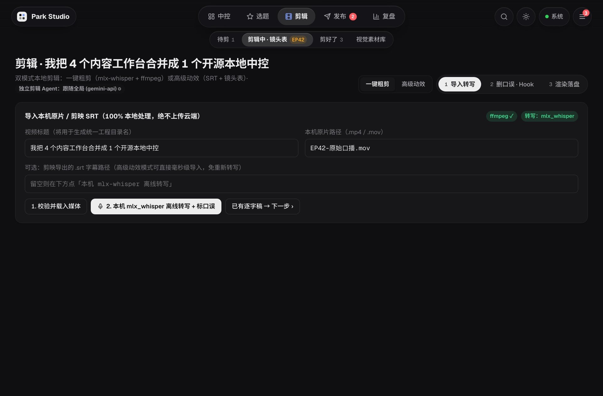
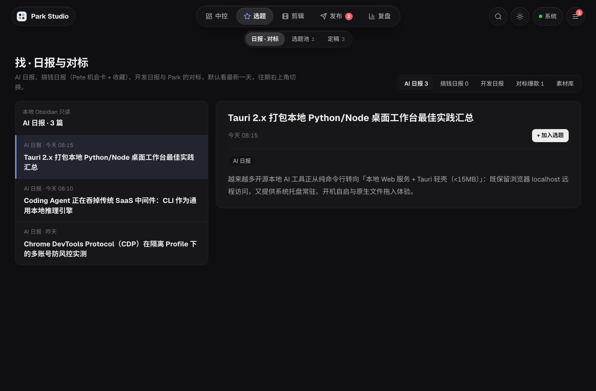
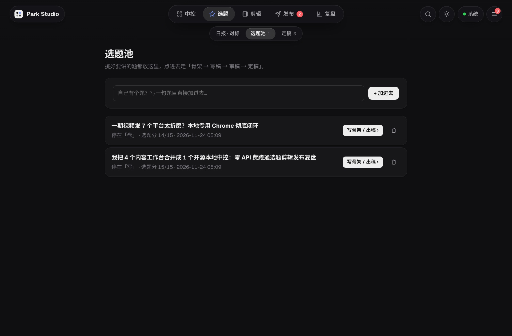
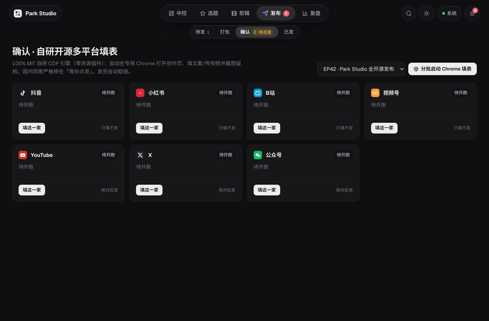
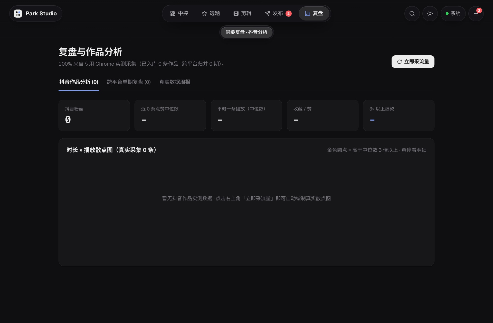
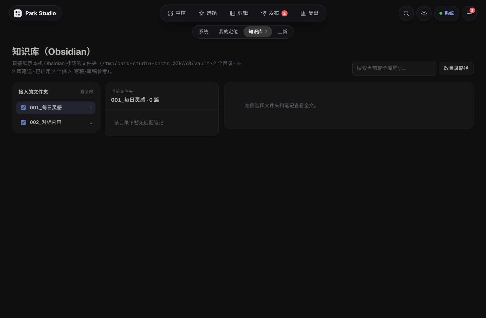
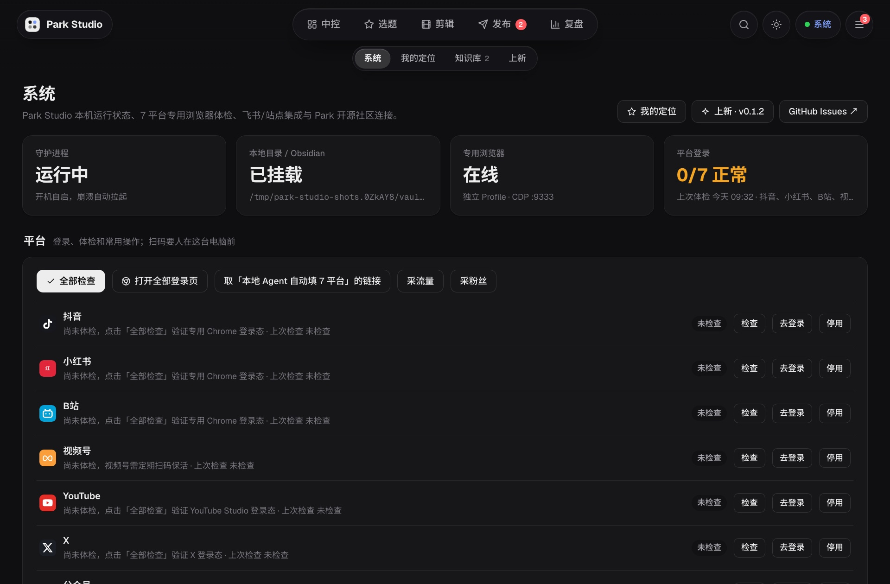
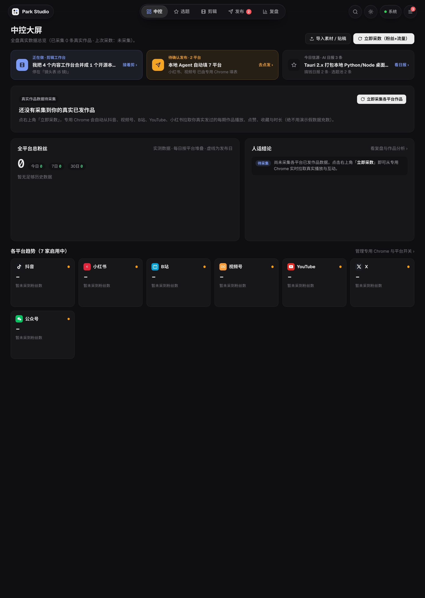

<div align="center">

# Park Studio

**简体中文** · [English](README.en.md)

> *「你拍一条 10 分钟口播，结果花 2 小时剪停顿、改文案、在多平台后台重复传视频。」*

[](https://python.org)
[](https://fastapi.tiangolo.com)
[](https://github.com/zinan92/park-studio/releases/latest)
[](https://github.com/zinan92/park-studio/releases/tag/v0.5.0)
[](LICENSE)

**把「选题 → 双模式本地剪辑 → 12 平台按需半自动填表 → 全网真实复盘」收拢进一个本地开源工作台，数据 100% 留在你的硬盘。**

[长什么样](#长什么样) · [它解决什么问题](#它解决什么问题) · [快速开始](#快速开始) · [架构](#架构) · [它和同类有什么不同](#它和同类有什么不同) · [安全边界](#安全边界) · [API 参考](#api-参考) · [For AI Agents](#for-ai-agents)

</div>

---

<p align="center"></p>
<p align="center"><sub>Park Studio 双模式本地剪辑工作台：原生检测本机 ffmpeg 与 mlx-whisper，支持一键粗剪与独立剪辑 Agent 动效镜头表。</sub></p>

```text
in   Obsidian 笔记/日报(只读) + 对标爆款目录 + 原片 .mp4/.mov 或剪映 .srt + 本地 AI 引擎
out  口播定稿 + 统一工程目录(final/上传/) + -16 LUFS faststart 成片 + 12 平台按需草稿 + 真实作品复盘库

fail 未安装 ffmpeg / mlx-whisper       → 剪辑台顶部体检胶囊标红并给出本机安装命令，不静默崩溃
fail 平台登录态过期或跳转登录页        → 专用 Chrome CDP 自动中止填表并标记需重扫，不误操作账号
fail 本地 AI CLI 报错（如旧 gemini-cli）→ 按配置自动回退至 Antigravity CLI (agy) 或环境变量 GEMINI_API_KEY
fail 尚未采集任何已发作品              → 大屏与复盘页如实显示空态与采集按钮，绝不伪造假数据充数
```

Adapters: `gemini-api` · `agy (Antigravity CLI)` · `gemini` · `claude` · `codex` · `openai-compatible api` · `mlx-whisper` · `faster-whisper` · `chrome-cdp (:9333)`

---

## 它解决什么问题

事情通常是这样的：你的选题散在 Obsidian、每日资讯和收藏夹里；口播拍完要先转字幕、剪掉停顿和说错重来的废句、统一音量；成片导出来以后，还要把同一个视频、三张不同比例的封面和一套文案，在抖音、小红书、B 站、视频号、YouTube、X、公众号、TikTok、Instagram、Threads、LinkedIn、Meta 等多平台后台反复上传粘贴；发完想复盘哪条跑出了 3 倍播放，又得切回各家后台抄数字。

> **支持 12 个平台，但绝不强制全填**：首次启动引导页（以及随时可重新打开的「选平台引导」）支持按需勾选——如果你平时只发 3 个或 5 个平台，就只选那几个，没勾的平台会自动隐藏，不会打扰体检、发布和大屏。

市面上要么是按月收订阅费、还要交出账号 Cookie 的云端 SaaS，要么是散落一地的脚本——脚本自己能跑通，换台电脑或者过两周自己都忘了命令怎么敲。

**Park Studio 换了一种思路**：一个纯本地运行的 FastAPI + SQLite 中控（带 1.7 MB 原生 Swift macOS 桌面壳），只用四个顶栏工作台串联整条生产线：

```text
[ 中控 | 选题 | 剪辑 | 发布 | 复盘 ]
```

能本地跑的绝不上云（语音转写用 `mlx-whisper` / `faster-whisper`，剪辑渲染用 `ffmpeg`，多平台填表用隔离 Profile 的专用 Chrome CDP，AI 推理直连你本机已有的 Gemini / Antigravity / Claude / Codex），没有强制 API 账单，也不碰你的日常浏览器和笔记原文件。

---

## 长什么样

所有截图均由仓库内置的脱敏脚本 [`scripts/capture-readme-screenshots.sh`](scripts/capture-readme-screenshots.sh) 在隔离临时目录实跑生成，零个人路径或账号隐私。

### 01 · 选题（日报 · 对标爆款 · 选题池）

| | |
|---|---|
|  |  |
| **输入（in）**：只读挂载本地 Obsidian 日报、搞钱机会卡、对标爆款库与素材库，一键 `+ 加入选题`。 | **推进**：选题池按「盘 → 写 → 审 → 定稿」推进，支持本机 AI 生成开头钩子与三路审稿。 |

### 02 · 剪辑（双模式本地剪辑台）与 发布（12 平台按需半自动填表）

| | |
|---|---|
|  |  |
| **双模式剪辑**：默认「一键粗剪」（`mlx-whisper` 离线转写 → 删口误/压停顿/挑 Hook → `-16 LUFS` 渲染）；切「高级动效」可导入 `.srt` 让独立剪辑 Agent 排 Spec Table。 | **输出（out）**：支持 12 平台按需启用，自研 MIT CDP 引擎在专用 Chrome 传视频、填标题文案与话题并回读校验；国内 4 家严格「只填不点发」。 |

### 03 · 诚实空态（Fail / Empty State）与 Obsidian 知识库

| | |
|---|---|
|  |  |
| **空态（fail/empty）**：尚未采集平台数据时直接提示「真实作品数据待采集」与一键采集入口，不用假数字糊弄。 | **知识库**：3 栏只读视图直观展示挂载的 Obsidian 文件夹，可按文件夹逐个开关 AI 写稿参考权限。 |

### 04 · 系统总览（12 平台按需体检 + 全局 / 剪辑 Agent 拆分）

| | |
|---|---|
|  |  |
| **系统台**：一屏看清守护进程、Obsidian 挂载、专用 Chrome `:9333` 与 12 平台按需开关体检；下方支持把写作 Agent、可选 API 预设（DeepSeek / OpenAI / OpenRouter / Ollama）与独立剪辑 Agent 拆开配置并一键测通。 | **中控大屏**：顶部「正在做」推进条直达停下的集数与待点发平台，下方汇总你已启用平台的真实粉丝与单期数据。 |

<details><summary>整页：中控大屏完整长截图</summary>
<p align="center"></p>
</details>

全部截图均存档于 [`docs/screenshots/`](docs/screenshots/)，任何人随时可运行 `bash scripts/capture-readme-screenshots.sh` 重录。

---

## 架构

```text
┌───────────────────────────┐     ┌────────────────────────────────────────┐
│ 本地输入 (只读 / 不篡改)    │     │ Park Studio 本地引擎 (FastAPI + SQLite) │
│ • Obsidian 知识库 & 日报   │────▶│  1. 选题: vault / benchmarks / materials│
│ • 对标爆款拆解目录         │     │  2. 剪辑: mlx-whisper + videocut + ffmpeg│
│ • 原片 .mp4/.mov / .srt    │     │  3. 发布: projects 标准目录 + cdp (:9333)│
└───────────────────────────┘     │  4. 复盘: metrics 真实作品跨平台归并     │
                                  └───────────────────┬────────────────────┘
                                                      │
         ┌────────────────────────────────────────────┼─────────────────────────────────┐
         ▼                                            ▼                                 ▼
┌─────────────────────┐                ┌─────────────────────────────┐      ┌──────────────────────┐
│ 本地 AI 引擎(可拆分)  │                │ 统一视频工程目录 (标准约定)   │      │ 专用 Chrome (CDP)    │
│ • 全局写作 Agent     │                │ YYYY-MM-DD_<标题>/final/上传/│      │ • 独立 Profile 隔离   │
│ • 独立剪辑 Agent     │                │   视频.mp4 + 3比例封面 + 文案 │      │ • 12 平台按需填表   │
│ (Gemini/agy/Codex..)│                │   + publish.json            │      │ • 国内 4 家只填不发   │
└─────────────────────┘                └─────────────────────────────┘      └──────────────────────┘
```

---

## 快速开始

### 方式 A：下载 macOS 桌面安装包（[Release v0.4.0](https://github.com/zinan92/park-studio/releases/tag/v0.4.0) · Universal 双架构）

从 [Releases](https://github.com/zinan92/park-studio/releases/latest) 下载 `Park-Studio.dmg`（1.7 MB 纯原生 Swift `WKWebView` 壳 + 内嵌后端，需本机已装 Python 3.11+ 及 `fastapi / uvicorn / pyyaml / httpx`），拖入「应用程序」双击打开。

### 方式 B：一行命令本地源码启动（macOS / Linux）

```bash
git clone https://github.com/zinan92/park-studio.git
cd park-studio
bash scripts/install.sh
```

启动后打开 `http://127.0.0.1:8792/`（首次启动可按界面引导配置本地目录与 AI 引擎）。

### 方式 C：交给你的 AI Agent 自动安装

把 [`agent-install.md`](agent-install.md) 或下面这句话直接发给 Gemini / Antigravity / Claude Code / Codex：

```text
请帮我把 https://github.com/zinan92/park-studio 克隆到本地、安装依赖并启动在 http://127.0.0.1:8792，顺便检查本机 ffmpeg 和 mlx-whisper 是否就绪。
```

### 装完后的第一句话（验证闭环）

1. 首次启动在**新手引导弹窗**中只勾选你真正在发的平台（从 12 个支持平台里选 1–5 个或全部都行，随时可在 `● 系统` 改）并选好 AI 引擎（支持 `Gemini API` / `Antigravity` / `Claude Code` / `Codex` / DeepSeek·OpenAI·OpenRouter·Ollama 可选 API，支持一键「测试 AI 连通性」）；
2. 切到 **`剪辑`** → 填入一条本地 `.mp4` 原片 → 点 **`本机 mlx_whisper 离线转写 + 标口误`** → 勾 1–2 句原话 Hook → 点 **`一键开始粗剪渲染并落盘`**；
3. 渲染完成后点 **`一键去发布工作台填表 ›`**，在专用 Chrome 里核对后亲自点击发布。

---

## 功能一览

| 模块 | 能力 | 交付产物 | 状态 |
|---|---|---|---|
| **选题** | 日报解析、对标爆款库（3× 筛选 + 追踪抓取 + **3 层可配置拆解 / Dan Koe 7 角度**）、选题池、三路审稿 | 选题卡片、7 角度一键开稿、口播定稿与标准工程目录 | 已完成 |
| **素材与知识库** | 2,656 款视觉素材库（图片 / 视频动效 / 做视频 / 视频案例分页预览）、3 栏只读 Obsidian 知识库 | 带 `{topic}` 自动替换的提示词、可控上下文范围 | 已完成 |
| **剪辑（粗剪）** | `mlx-whisper` / `faster-whisper` 本地转写、自动标停顿/重来/语气词、Hook 勾选、`ffmpeg` `-16 LUFS` 渲染、**一键生成英文 `.srt` 外挂字幕** | `faststart` 成片 `.mp4`（含可选 ASS 字幕）+ 英文 `.srt`，自动落盘到 `final/上传/` | 已完成 |
| **剪辑（动效）** | 剪映 `.srt` 毫秒解析、独立剪辑 Agent 排 Spec Table 镜头表、后台实时日志 | `worktable.json` + 镜头卡方案 | 已完成 |
| **发布** | 统一工程目录扫描、**一键 AI 分平台本地化改写（中文 → 地道英文标题/正文/Hashtags）**、**12 平台按需启用**严格回读校验填表 | 分平台中/英 `publish.json` + 平台草稿页 + 提交前 JPEG 截图存档 | 已完成 |
| **复盘与双语** | 多平台真实作品与粉丝采集、同内容跨平台归并、7 页签定位卡、**全站 `中 / EN` 双语界面切换** | 真实播放/互动散点图、跨平台单期复盘表 | 已完成 |

---

## 它和同类有什么不同

| 维度 | 云端多平台分发 SaaS | 零散 CLI / 自动化脚本 | Park Studio |
|---|---|---|---|
| **账号与数据归属** | 需托管 Cookie / OAuth，数据在第三方服务器 | 本地运行，但配置和产物散落各处 | **100% 留在 `~/.park-studio/` 与本地硬盘**，零云端上传 |
| **AI 与转写费用** | 绑定平台按月/按字数付费 | 各自独立配置 Key | **零强制付费 API**：直连本机 `mlx-whisper` + 本机 CLI / 自带 `GEMINI_API_KEY` |
| **发布风控边界** | 全自动接口发布，易触发风控或误发 | 容易漏核对封面/话题 | 隔离专用 Chrome Profile；**国内 4 家严格「只填不点发」**，最后确认归人 |
| **全链路衔接** | 只做分发或只做剪辑，中间靠人搬文件 | 每步手动传文件路径 | 统一工程目录规范，**剪完自动落盘并载入发布台** |

---

## 安全边界

- **国内 4 家平台绝不代点最终发布**：抖音、小红书、B 站、视频号严格停在「视频已传、标题文案与话题已填、已截提交前存档图」，必须由创作者亲自核对并点击发布。
- **Obsidian 笔记库严格只读**：只扫描和读取 `.md` 文件用于展示与上下文检索，绝不修改、重命名或删除你的任何笔记。
- **不碰你的日常浏览器**：多平台自动化运行在独立目录 `~/.park-studio/chrome-profile`（CDP `:9333`），与你日常 Chrome 完全隔离。
- **开源仓库零个人隐私**：你的目录路径、AI 配置、数据库与截图全部存在 `~/.park-studio/`；代码仓库通过隐私正则扫描确保零私人路径、Cookie 或密钥。

---

## API 参考

本地服务默认监听 `http://127.0.0.1:8792`，核心 HTTP 接口如下：

| 方法 | 路径 | 说明 |
|---|---|---|
| `GET` | `/api/health` | 健康检查（桌面端与守护进程心跳使用） |
| `GET` | `/api/bootstrap` | 一次性加载配置、选题、剪辑工程、发布队列、复盘与环境体检 |
| `GET` | `/api/cut/env` | 检测本机 `ffmpeg`、滤镜、`mlx_whisper`/`faster_whisper` 与独立剪辑 Agent 状态 |
| `POST` | `/api/cut/{cut_id}/import-media` | 导入本地 `.mp4/.mov` 原片或 `.srt` 字幕并解析句级时间戳 |
| `POST` | `/api/cut/{cut_id}/transcribe` | 后台启动本机离线语音转写 + 口误/停顿分析，返回 `job.id` |
| `POST` | `/api/cut/{cut_id}/ai-plan` | 调用独立剪辑 Agent 挑原话 Hook 并排 Spec Table 动效镜头表 |
| `POST` | `/api/cut/{cut_id}/render` | 后台执行一键粗剪渲染（两遍 `-16 LUFS` + ASS 字幕 + `faststart` + 自动落盘发布台） |
| `GET` | `/api/cut/jobs/{job_id}` | 轮询后台剪辑任务状态与实时时间戳日志 |
| `POST` | `/api/publish/from-project` | 扫描统一工程目录 `final/上传/` 并一键导入发布工作台 |
| `POST` | `/api/publish/{ep_id}/fill` | 启动专用 Chrome CDP 自动填充指定平台草稿页（只填不发） |
| `POST` | `/api/metrics/collect` | 通过专用 Chrome 采集各平台真实已发作品播放/互动并跨平台归并 |
| `GET` | `/api/kb/tree` | 列出 Obsidian 根目录挂载文件夹与启用状态 |

---

## 技术栈与项目结构

| 层级 | 技术 | 用途 |
|---|---|---|
| 后端运行时 | Python 3.11+ · FastAPI · Uvicorn · httpx | 本地 API 服务、后台剪辑任务队列、AI 引擎调度 |
| 数据存储 | SQLite (`~/.park-studio/studio.db`) + YAML (`config.yaml`) | 选题、剪辑方案、发布状态、真实作品快照本地持久化 |
| 本地音视频 | `mlx-whisper` / `faster-whisper` · `ffmpeg` (`loudnorm` + `libass`) | 零费用离线转写、自动删口误/停顿、响度统一与字幕烧录 |
| 浏览器自动化 | 自研 MIT Chrome DevTools Protocol (`cdp.py`) | 隔离专用 Chrome 多平台填表与真实数据采集 |
| 桌面端壳 | 原生 Swift + Apple `WKWebView` (`desktop/macos/`) | 106 KB 透明融合标题栏 macOS App，零 Electron 内存开销 |

```text
park-studio/
├── src/park_studio/
│   ├── app.py            # FastAPI 主路由与 SSE/轮询任务接口
│   ├── ai.py             # 多后端 AI 引擎（Gemini API / agy / Claude / Codex / 独立剪辑 Agent）
│   ├── cutter.py         # 双模式本地剪辑引擎 + CutJobManager 后台队列 + 自动落盘
│   ├── videocut.py       # 停顿/重来/语气词分析与 ffmpeg 滤镜图 + ASS 字幕生成器
│   ├── cdp.py            # 100% MIT 自研 Chrome DevTools Protocol 客户端
│   ├── publisher.py      # 12 平台按需半自动填表器（Shadow DOM 穿透 + 严格回读门禁）
│   ├── metrics.py        # 真实作品指标采集与跨平台单期归并
│   ├── benchmarks.py     # 对标爆款库、3× 筛选与 3 层可配置 7 角度 AI 拆解
│   ├── materials.py      # 2,656 款视觉素材库（图片 / 视频动效 / 做视频 / 视频案例）
│   ├── vault.py          # Obsidian 只读扫描与知识库检索
│   └── static/           # 原生零构建前端（Apple Liquid Glass 悬浮双栏工作台）
├── desktop/macos/        # 原生 Swift WKWebView 桌面壳源码
├── scripts/              # 安装脚本、DMG 打包脚本与 README 截图复现脚本
├── docs/screenshots/     # 脱敏真实界面截图
└── tests/                # 端到端自动化测试（18 项，含真实 ffmpeg 合成渲染与落盘）
```

---

## 配置

所有个人配置存于 `~/.park-studio/config.yaml`（亦可在界面 `● 系统` 直接修改，无需手改文件）：

| 配置项 / 环境变量 | 说明 | 必填 | 默认值 |
|---|---|---|---|
| `obsidianPath` | 本地 Obsidian 笔记库根目录（只读） | 否 | 空（未挂载） |
| `projectRoot` | 统一视频工程根目录（剪完自动落盘目录） | 否 | `~/Movies/ParkStudio` |
| `aiBackend` | 全局 AI 引擎：`gemini-api` \| `agy` \| `gemini` \| `claude` \| `codex` \| `api` | 否 | `gemini` |
| `cutAgentBackend` | 剪辑台独立 Agent：`inherit`（跟随全局）或指定任意引擎 / `custom` | 否 | `inherit` |
| `transcribeEngine` | 本机离线语音转写：`mlx-whisper` \| `faster-whisper` | 否 | `mlx-whisper` |
| `GOOGLE_API_KEY` / `GEMINI_API_KEY` | 使用 `gemini-api` 时的环境变量 | 仅选 `gemini-api` 时 | 无 |
| `PARK_STUDIO_DATA` | 覆盖本地数据目录路径（测试/多实例隔离用） | 否 | `~/.park-studio` |

---

## 验证与测试

仓库自带 [18 项端到端测试](tests/)（覆盖 Obsidian 路径穿越防护、多 AI 引擎回退、12 平台按需引导、3 层可配 7 角度拆解、2,656 素材库分页、MP4 `faststart` 校验、统一工程目录导入、跨平台作品归并，以及用 `ffmpeg` 生成真实 3 秒视频完成 `-16 LUFS` 渲染 + ASS 字幕烧录 + 自动落盘发布台）：

```bash
PYTHONPATH=src python3 -m pytest -v
# tests/test_step1.py   4 passed
# tests/test_step2.py   3 passed
# tests/test_step3.py  11 passed
# ==================== 18 passed ====================
```

---

## For AI Agents

本节面向需要将 Park Studio 作为本地内容生产后端调用的 AI Agent。

### Capability Contract

```yaml
name: park-studio
version: 0.3.0
capability:
  summary: Local Creator OS uniting Obsidian intel, configurable 7-angle benchmark teardown, dual-mode video rough-cut/motion planning, 12-platform opt-in CDP draft auto-fill, and real cross-platform analytics.
  in: Read-only Obsidian vault + benchmark teardown notes + local raw video (.mp4/.mov) or .srt + local AI CLI/API
  out: Structured scripts + standardized episode folder (final/上传/) + -16 LUFS faststart MP4 + pre-filled platform drafts with pre-submit screenshots + SQLite real metrics
  fail:
    - "ffmpeg or mlx-whisper missing -> /api/cut/env reports ready=false with exact install hints"
    - "platform session expired -> CDP publisher aborts fill and marks platform re-login required"
    - "local gemini-cli unavailable -> automatic fallback to agy or GEMINI_API_KEY when set"
    - "no live works collected -> analytics returns hasLiveWorks=false without fabricated demo numbers"
  adapters: [gemini-api, agy, gemini, claude, codex, openai-api, mlx-whisper, faster-whisper, chrome-cdp]
api_base_url: http://127.0.0.1:8792
endpoints:
  - path: /api/cut/env
    method: GET
    description: Inspect local ffmpeg, whisper engine, and independent cut Agent readiness
  - path: /api/cut/{cut_id}/import-media
    method: POST
    description: Bind local .mp4/.mov and optional .srt into a cut project
    body:
      content_type: application/json
      schema:
        title: string
        video_path: string
        srt_path: string
        mode: "rough | motion"
  - path: /api/cut/{cut_id}/transcribe
    method: POST
    description: Start background local whisper transcription and retake/pause analysis
  - path: /api/cut/{cut_id}/render
    method: POST
    description: Start background 2-pass -16 LUFS rough cut render and auto-land into publish workbench
  - path: /api/publish/{ep_id}/fill
    method: POST
    description: Auto-fill specified platform draft page via isolated Chrome CDP (fill-only guard)
install_command: bash scripts/install.sh
start_command: PYTHONPATH=src python3 -m park_studio.server serve --host 127.0.0.1 --port 8792
health_check: GET /api/health
```

### Agent 调用示例

```python
import time
import httpx

base = "http://127.0.0.1:8792"
client = httpx.Client(base_url=base, trust_env=False, timeout=30.0)

# 1. 导入本机原片并启动 mlx-whisper 离线转写
client.post("/api/cut/1/import-media", json={
    "title": "开源本地内容中控实测",
    "video_path": "/path/to/raw.mp4",
    "mode": "rough",
}).raise_for_status()

job_id = client.post("/api/cut/1/transcribe", json={"lang": "zh"}).json()["job"]["id"]
while True:
    st = client.get(f"/api/cut/jobs/{job_id}").json()
    if st["state"] in ("done", "failed"):
        break
    time.sleep(2)

# 2. 一键渲染 -16 LUFS 成片并自动落盘至发布工作台
render_job = client.post("/api/cut/1/render", json={"mode": "rough", "burn_subs": True}).json()["job"]["id"]
print("render job:", render_job)
```

---

## License

[MIT](LICENSE)

---

<div align="center">

*选题 · 粗剪 · 填表 · 复盘 — 数据留在自己硬盘，把时间留给表达本身。*

</div>
